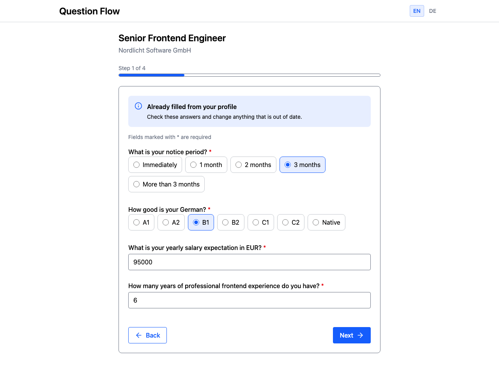

# question-flow

[](https://github.com/soheilaghayour/question-flow/actions/workflows/ci.yml)

A candidate-facing application question flow. After clicking **Apply** on a job, the
candidate answers the company's screening questions in a short wizard. Answers the profile
already holds are prefilled for confirmation, and submitting produces the exact answer
payload, screening verdict included, defined in [the contract](docs/task-contract.md).
Job configs are written by recruiters and can be broken, so every config is cleaned up
before it renders.



Built with React 19, TypeScript (strict), Vite, Tailwind v4, react-router, zod, Vitest and
Testing Library.

## Running it

```sh
npm install
npm run dev        # start the app (pick one of the three job configs on the job page)
npm test           # run the test suite
npm run lint       # eslint
npm run typecheck  # tsc -b
npm run build      # typecheck + production build
```

## How it's built

```
Raw Config ──▶ normalizeJob() ──▶ Wizard Flow (Confirm → 3/step → Review) ──▶ Submit
                      │                                                        │
                 Pure logic                                              console.log(payload)
                 (no React)                                              + Result Screen
```

### Architecture

- **Code lives next to where it is used.** Each screen has its own folder under
  [`src/pages/`](src/pages) with its components and logic; code shared across screens sits
  in the root folders (D40).
- **Pure decision logic.** Business logic is plain TypeScript with no React: normalizing
  configs ([`src/data/`](src/data)), prefill, screening, wizard steps and the payload
  ([`src/pages/apply-flow/`](src/pages/apply-flow)). It is tested without rendering anything.
- **A design system.** [`components/ui/`](src/components/ui) holds the generic building
  blocks and is the only place raw form controls live; every other component builds on it.
  [`questions/`](src/pages/apply-flow/questions) has one component per question type. Colors
  are semantic tokens (`text-error`, `bg-primary`), so a design change stays one line (D13).
- **A question registry.** [`registry.ts`](src/pages/apply-flow/questions/registry.ts) maps each
  question type to its component, and the flow never switches on type. Adding a type means
  one new component and one registry entry; the compiler checks that every type is covered.
- **Every screen has a URL** ([`routes.tsx`](src/routes.tsx), D35): the job page, the
  wizard with its step in `?step=N`, and the confirmation. Browser Back and Forward move
  between steps.

### Data model

- **Validation at the trust boundary.** Fixtures enter only through
  [`src/data/`](src/data/index.ts), and raw job configs stay `unknown` until
  [`normalizeJob()`](src/data/normalize.ts) parses them with the
  [zod schemas](src/data/schema.ts). Each question is parsed on its own: a broken question,
  option or rule is dropped with a console warning, and the rest of the job still works. A
  job that can't be shown honestly becomes an error state, never a crash (D10).
- **Prefill only valid values.** A profile value is prefilled only if it is a valid answer
  to the question, e.g. an existing option or a number within range
  ([`prefill.ts`](src/pages/apply-flow/prefill.ts), D7).
- **Form state holds real answers only.** `null` means "no answer", so `false` and `0` stay
  answers (D19, D21). The answers live in the flow; React context carries only the UI
  language (D2).
- **Wizard steps are derived, not stored.** Prefilled answers come first as one confirm
  step, then three questions per step in config order ([`wizard.ts`](src/pages/apply-flow/wizard.ts),
  D30).

### Interfaces

- **One interface for every question component:** `{ question, value, onChange, error? }`
  (`QuestionComponent` in [`registry.ts`](src/pages/apply-flow/questions/registry.ts), D21). All
  question components are controlled.
- **The answer payload** follows [the contract](docs/task-contract.md#answer-payload)
  exactly: `value` or `values` depending on `max_choices`, JSON numbers and booleans, plain
  base64 for files ([`payload.ts`](src/pages/apply-flow/payload.ts)). Screening rules are evaluated
  into the payload and never block submission (D8); candidates see the same neutral
  confirmation either way (D24).

### Accessibility, i18n and errors

- Labels are tied to their inputs, option groups use `fieldset` and `legend`, and errors
  are announced via `aria-invalid`, `aria-describedby` and `role="alert"` (D12, D13).
  Required fields carry `aria-required` (D26), and focus rings show for keyboard users only
  (D28).
- Every field reserves a line for its error, so an error appearing doesn't push the form
  down (D39).
- The UI is in English and German with a typed `t(key)` ([`src/i18n/`](src/i18n), D14). The
  choice is saved in the browser; recruiter text is always shown as written (D3).
- Numbers parse the same in every locale: `85.000`, `85,000` and `85 000` all mean 85000,
  and decimals are rejected ([`parseLocaleNumber.ts`](src/pages/apply-flow/parseLocaleNumber.ts), D6).

The D-numbers refer to entries in [`DECISIONS.md`](DECISIONS.md).

## Where things live

- [`docs/task-contract.md`](docs/task-contract.md) — the task contract (frozen fixture):
  job config format, question types, screening rules, payload shape. The source of truth;
  every rule in it has a test.
- [`DECISIONS.md`](DECISIONS.md) — every judgment call the contract left open, with its
  reason. Includes rejected approaches and open PM questions.
- [`PRD.md`](PRD.md) — the problem, the users, and what V1 and V2 cover.
- [`CLAUDE.md`](CLAUDE.md) — project structure, naming conventions, and the working
  agreements under which this repo is built.
- `jobs/*.json`, `profile.json` — mock data fixtures (frozen, including the deliberately
  broken `bad.json`).

## Contributing

- Work starts as a GitHub issue; each issue gets its own branch and pull request.
- A product decision goes into [`DECISIONS.md`](DECISIONS.md) in the same commit as the code
  that implements it.
- Tests sit next to the file they test. Every contract rule has a test, and each job
  config has an integration test.
- Run `npm run typecheck && npm run lint && npm test` before committing. CI runs the same
  checks plus the build on every pull request.
- The fixtures and the contract are frozen; new test data goes into new files
  (e.g. [`jobs/edge-cases.json`](jobs/edge-cases.json)).
- Conventions and rules are in [`CLAUDE.md`](CLAUDE.md).
